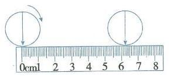

# Mathematics (Grade 6)

**ID**: 5f993833
**难度**: medium
**题型**: multiple_choice

## 题目
从图中可以看出，这个圆的直径大约是（   ）厘米

 A．1
 B．2
 C．3.14
 D．0.5

## 解答

**答案**: B

1. Step1:观察图形可知圆滚动一周对应的长度从0cm到6.28cm，所以圆滚动一周的长度为6.28厘米
2. Step2:因为圆滚动一周的长度就是圆的周长，所以此圆的周长为6.28厘米
3. Step3:根据圆的周长公式C = πd（C表示周长，d表示直径，π通常取3.14），可得直径d = C÷π
4. Step4:将周长C = 6.28厘米，π = 3.14代入公式，计算出圆的直径为6.28÷3.14 = 2厘米
5. Step5:对比选项，答案为B

## 知识点

**知识点**:
  - 图形与测量;

---
