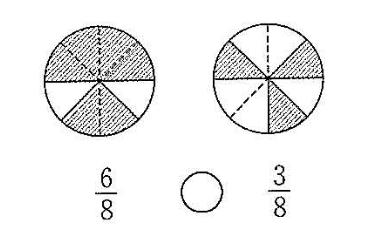

# Mathematics (Grade 6)

**ID**: 62229920
**难度**: medium
**题型**: multiple_choice

## 题目
下面的○里应填（ ）

   A、＞
   B、＜
   C、无法确定

## 解答

**答案**: A

1. Step1:观察图形，第一个圆被平均分成8份，阴影部分占6份，对应的分数是$\frac{6}{8}$；第二个圆被平均分成8份，阴影部分占3份，对应的分数是$\frac{3}{8}$
2. Step2:根据同分母分数比较大小的方法，分母相同，分子越大分数越大
3. Step3:因为6＞3，所以$\frac{6}{8}$＞$\frac{3}{8}$，所以○里应填＞，答案选A

## 知识点

**知识点**:
  - 总复习-期末综合测试
-

---
