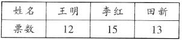

# Mathematics (Grade 6)

**ID**: 69ab9c63
**难度**: medium
**题型**: multiple_choice

## 题目
有三名同学参加二一班的竞选班长投票，这是全部同学的投票结果，（   ）会选上班长．

A．王明
B．李红
C．田新

## 解答

**答案**: B

1. Step1:观察投票结果表格，王明票数为12，李红票数为15，田新票数为13。
2. Step2:比较三人票数大小，15＞13＞12，即李红票数最多。
3. Step3:因为在竞选班长投票中，票数最多的人会选上班长，所以李红会选上班长，答案是B。

## 知识点

**知识点**:
  - 小学数学;数与代数;数的认识;整数的认识

---
