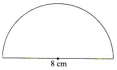

# Mathematics (Grade 6)

**ID**: 69f789c5
**难度**: medium
**题型**: multiple_choice

## 题目
如图所示的图形的周长是(  )。

A．25. 12 cm
B．12. 56 cm
C．20. 56 cm

## 解答

**答案**: C

1. Step1:明确半圆的周长由圆周长的一半和一条直径组成
2. Step2:已知圆的直径为8cm，根据圆的周长公式C = πd（d为直径），可得圆周长的一半为3.14×8÷2 = 12.56cm
3. Step3:直径为8cm
4. Step4:半圆的周长为圆周长的一半加上直径，即12.56 + 8 = 20.56cm
5. Step5:对比选项，答案为C

## 知识点

**知识点**:
  - 

---
