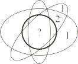

# Mathematics (Grade 6)

**ID**: 6b21c6c8
**难度**: medium
**题型**: multiple_choice

## 题目
如果你仔细观察，就会明白数字与图形之间存在的逻辑关系．请问，问号代表的数应是(    )．

## 解答

**答案**: 4

1. Step1:观察图形和数字，发现‘1’表示只属于大圆中的一部分
2. Step2:发现‘2’表示属于两个图形的公共部分
3. Step3:看到‘？’是四个图形的公共部分
4. Step4:根据前面发现的逻辑关系，得出‘？’代表的数是4

## 知识点

**知识点**:
  - 事物的简单搭配规律．

---
