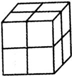

# Mathematics (Grade 6)

**ID**: 6bb64621
**难度**: medium
**题型**: multiple_choice

## 题目
如图是用8个同样大小的小正方体拼成的，如果任意拿走1个小正方体，它的表面积与原来相比（  ）
A．增加了
B．减小了
C．不变

## 解答

**答案**: C

1. Step1:观察图形可知这是由8个同样大小的小正方体拼成的物体，且每个小正方体都在顶点处
2. Step2:分析顶点处小正方体的外露面情况，得出每个小正方体都外露3个面
3. Step3:考虑任意拿走1个小正方体的情况，发现拿走后会外露相同的3个面
4. Step4:根据表面积的概念，由于拿走前后外露面的数量不变，所以它的表面积与原来相比不变，答案选C

## 知识点

**知识点**:
  - 长方体和正方体的表面积．

---
