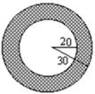

# Mathematics (Grade 6)

**ID**: 6e8335df
**难度**: medium
**题型**: multiple_choice

## 题目
如下图（单位：cm），求环形面积，列式正确的是（     ）。

$\begin{description}
\item A．3.14×30^{2}－20^{2}\item B．3.14×（30－20）^{2}\item C．3.14×（30^{2}－20^{2}）
\end{description}$

## 解答

**答案**: C

1. Step1:明确环形面积公式为$S = \pi(R^{2}-r^{2})$，其中$R$是外圆半径，$r$是内圆半径。
2. Step2:由图可知外圆半径$R = 30$cm，内圆半径$r = 20$cm。
3. Step3:将$R = 30$，$r = 20$代入环形面积公式，得到$S = 3.14×(30^{2}-20^{2})$，所以列式正确的是C选项。

## 知识点

**知识点**:
  - 小学数学;图形与几何;平面图形;圆;圆环的面积

---
