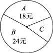

# Mathematics (Grade 6)

**ID**: 6f882e95
**难度**: medium
**题型**: multiple_choice

## 题目
可可用自己的零花钱刚好购买了A，B，C三种物品(如图)，如果购买A物品用了总钱数的36%，则购买C物品用了总钱数的(  )%。

A．78
B．16
C．22
D．11

## 解答

**答案**: B

1. Step1:先计算购买A、B物品一共花费的钱数，即18 + 24 = 42元
2. Step2:设总钱数为x元，因为购买A物品用了总钱数的36%，则A物品花费0.36x元，已知A物品花费18元，所以0.36x = 18，可解得x = 18÷0.36 = 50元
3. Step3:计算购买C物品花费的钱数为50 - 42 = 8元
4. Step4:计算购买C物品花费的钱数占总钱数的百分比，即8÷50×100% = 16%

## 知识点

**知识点**:
  - 小学数学;数与代数;应用题;百分数应用题

---
