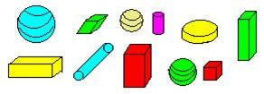

# Mathematics (Grade 6)

**ID**: 73efb445
**难度**: medium
**题型**: multiple_choice

## 题目
下图中，有________个球。（    ）

A．2
B．3
C．4
D．5

## 解答

**答案**: B

1. Step1:仔细观察图片中的立体图形
2. Step2:逐一分辨每个图形，确定哪些是球
3. Step3:数出球的数量为3个
4. Step4:对比选项，发现选项B符合球的数量

## 知识点

**知识点**:
  - 

---
