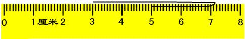

# Mathematics (Grade 6)

**ID**: 75f98f2b
**难度**: medium
**题型**: multiple_choice

## 题目
如果将下图中的绳子拉直，它的长度大约为(  )厘米．

A．4
B．5
C．6
D．8

## 解答

**答案**: C

1. Step1:明确绳子分为两段，第一段从3厘米处到7厘米处，第二段从5厘米处到7厘米处
2. Step2:计算第一段绳子的长度，用7厘米减去3厘米，即7 - 3 = 4厘米
3. Step3:计算第二段绳子的长度，用7厘米减去5厘米，即7 - 5 = 2厘米
4. Step4:将两段绳子的长度相加，4 + 2 = 6厘米，所以绳子拉直后的长度大约为6厘米
5. Step5:对比选项，答案为C

## 知识点

**知识点**:
  - 长度的测量方法．

---
