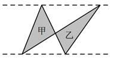

# Mathematics (Grade 6)

**ID**: 791b5ff9
**难度**: medium
**题型**: multiple_choice

## 题目
如下图:在一组平行线间画了下面的图形，甲乙的面积相比(     ) 

A．甲>乙
B．甲<乙
C．甲=乙

## 解答

**答案**: C

1. Step1:观察图形可知，甲和乙分别加上它们中间空白的三角形，可组成两个新的三角形。
2. Step2:这两个新三角形等底等高，根据三角形面积公式S = 1/2ah（a为底，h为高），等底等高的三角形面积相等，所以这两个新三角形面积相等。
3. Step3:因为两个新三角形面积相等，都减去中间相同的空白三角形面积后，剩余的甲和乙的面积也相等。
4. Step4:所以甲乙的面积相比甲=乙，答案选C。

## 知识点

**知识点**:
  - 

---
