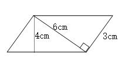

# Mathematics (Grade 6)

**ID**: 7942d14a
**难度**: medium
**题型**: multiple_choice

## 题目
下面图形面积是（  ）

$\begin{description}
\item A．12cm^{2}\item B．24cm^{2}\item C．18cm^{2}
\end{description}$

## 解答

**答案**: C

1. Step1:观察图形可知这是一个平行四边形
2. Step2:平行四边形面积公式为S = 底×高
3. Step3:从图中可知底为3cm，对应的高为6cm
4. Step4:根据面积公式计算面积S = 3×6 = 18cm²
5. Step5:对比选项，答案为C

## 知识点

**知识点**:
  - 小学数学;图形与几何;平面图形;平行四边形;平行四边形的面积

---
