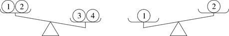

# Mathematics (Grade 6)

**ID**: 7b226424
**难度**: medium
**题型**: multiple_choice

## 题目
有4颗外表一模一样的玻璃珠子，其中有一颗玻璃珠子是次品（质量轻一些）。下面是李思找次品的过程：

根据李思找次品的过程，可以知道（   ）号玻璃珠是次品。
$\begin{description}
\item A．①\item B．②\item C．③\item D．④
\end{description}$

## 解答

**答案**: B

1. Step1:根据第一个天平图，1和2的一端下沉，3和4的一端上翘，可知次品在3或4中。
2. Step2:根据第二个天平图，1下沉，2上翘，可知2比1轻。
3. Step3:结合前面步骤，由于次品是轻的，且第一个天平图显示3、4中有次品，第二个天平图显示2轻，所以次品是2号玻璃珠。

## 知识点

**知识点**:
  - 小学数学;数与代数;应用题;常见的数学问题;找次品

---
