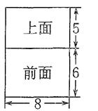

# Mathematics (Grade 6)

**ID**: 7bc51b82
**难度**: medium
**题型**: multiple_choice

## 题目
把一个长方体纸盒相邻的两面撕下来，展开后如下图（单位：厘米）所示。这个纸盒的前面比左面大（  ）平方厘米。

$\begin{description}
\item A．48\item B．40\item C．30\item D．18
\end{description}$

## 解答

**答案**: D

1. Step1:观察图形可知，前面长方形的长是8厘米，宽是6厘米，根据长方形面积公式S = a×b（其中S是面积，a是长，b是宽），可得前面的面积为8×6 = 48平方厘米
2. Step2:上面长方形的长是8厘米，宽是5厘米，由于上面和左面相邻，所以左面长方形的长是6厘米，宽是5厘米，其面积为6×5 = 30平方厘米
3. Step3:求前面比左面大的面积，用前面的面积减去左面的面积，即48 - 30 = 18平方厘米

## 知识点

**知识点**:
  - 

---
