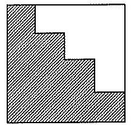

# Mathematics (Grade 6)

**ID**: 7c7b4a90
**难度**: medium
**题型**: multiple_choice

## 题目
下图是边长为5厘米的正方形，其中阴影部分的周长（    ）．
   A．等于20厘米
   B．大于20厘米
   C．小于20厘米

## 解答

**答案**: C

1. Step1:明确正方形边长为5厘米
2. Step2:根据阴影部分的周长=3×边长这一关系
3. Step3:计算3×5=15厘米
4. Step4:对比选项，15厘米小于20厘米，得出答案为C

## 知识点

**知识点**:
  - 第二单元达标测试卷--

---
