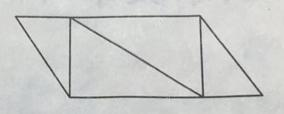

# Mathematics (Grade 6)

**ID**: 7c7f2729
**难度**: medium
**题型**: multiple_choice

## 题目
下面图形中有（    ）个梯形.

 A.2
 B.3
 C.4
 D.5

## 解答

**答案**: C

1. Step1:明确梯形的定义，即只有一组对边平行的四边形，平行的两边分别为底边，较长的是下底，较短的是上底
2. Step2:观察给定图形，从左到右、从上到下依次寻找符合梯形定义的图形
3. Step3:发现左边斜着的四边形是一个梯形，中间被对角线分开的两个四边形也是梯形，右边斜着的四边形同样是梯形，一共4个
4. Step4:对比选项，发现选项C对应的是4个，所以答案是C

## 知识点

**知识点**:
  - --

---
