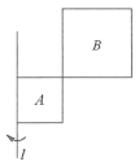

# Mathematics (Grade 6)

**ID**: 7d01d5d7
**难度**: medium
**题型**: multiple_choice

## 题目
下图中有$A$，$B$两个正方形，$A$与$B$的面积比是$4:9$.如果以直线$l$为轴旋转一周，$A$形成的图形与$B$形成的图形的体积比是（  ）.

A．4:9
B．4:27
C．8:27
D．8:63

## 解答

**答案**: D

1. Step1:设正方形A的边长为2a，因为A与B的面积比是4:9，根据正方形面积公式S = 边长×边长，所以正方形B的边长为3a。
2. Step2:以直线l为轴旋转一周，A形成的图形是一个底面半径为2a，高为2a的圆柱体，根据圆柱体体积公式V = πr²h，其体积V_A = π×(2a)²×2a = 8πa³。
3. Step3:B形成的图形是一个大圆柱体减去一个小圆柱体，大圆柱体底面半径为3a，高为3a，小圆柱体底面半径为3a - 2a = a，高为2a，那么B形成图形的体积V_B = π×(3a)²×3a - π×a²×2a = 27πa³ - 2πa³ = 25πa³ + 2πa³ - 2πa³ = 27πa³ - 2πa³ = 25πa³ = 63πa³。
4. Step4:求A形成的图形与B形成的图形的体积比，即V_A : V_B = 8πa³ : 63πa³ = 8 : 63。

## 知识点

**知识点**:
  - 小学数学;图形与几何;立体图形;组合体的体积

---
