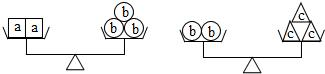

# Mathematics (Grade 6)

**ID**: 7ed06ccf
**难度**: medium
**题型**: multiple_choice

## 题目
如图所示，对a、b、c三种物体的重量判断正确的是(  )

A．a＜c
B．a＜b
C．a＞c
D．b＜c

## 解答

**答案**: C

1. Step1:根据图中天平平衡可知，2个a的重量等于3个b的重量，即2a = 3b
2. Step2:由2a = 3b，因为3＞2，所以a＞b
3. Step3:根据图中另一个天平平衡可知，2个b的重量等于3个c的重量，即2b = 3c
4. Step4:由2b = 3c，因为3＞2，所以b＞c
5. Step5:由a＞b且b＞c，可推出a＞b＞c
6. Step6:逐一分析选项，A选项a＜c错误，B选项a＜b错误，C选项a＞c正确，D选项b＜c错误，所以答案选C

## 知识点

**知识点**:
  - 比较大小;简单的等量代换问题．

---
