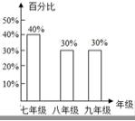

# Mathematics (Grade 6)

**ID**: 8000f816
**难度**: medium
**题型**: multiple_choice

## 题目
如图是某校初中段各年级人数占初中总人数百分比情况统计图，已知八年级有学生105人，那么七年级的学生数是（  ）

A．350
B．105
C．140
D．不能确定

## 解答

**答案**: C

1. Step1:根据统计图可知八年级人数占初中总人数的30%，且已知八年级有学生105人，所以用八年级人数除以其占比可求出初中总人数，即105÷30% = 350人
2. Step2:由统计图得知七年级人数占初中总人数的40%，已求出初中总人数为350人，那么七年级学生数为350×40% = 140人

## 知识点

**知识点**:
  - 小学数学;统计和概率;统计;统计图;简单条形统计图;统计图表的综合应用

---
