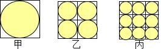

# Mathematics (Grade 6)

**ID**: 83fbbb60
**难度**: medium
**题型**: multiple_choice

## 题目
小明有三张同样大小的正方形纸，用下面三种不同的方法分别剪下一些圆形，那么三种剪法中，每张纸的的利用率（    ）。

$\begin{description}
\item A．甲高\item B．乙高\item C．丙高\item D．一样高
\end{description}$

## 解答

**答案**: D

1. Step1:设正方形纸的边长为a。
2. Step2:计算甲图中圆的半径r1 = a/2，其面积S1 = π×(a/2)² = πa²/4。
3. Step3:计算乙图中每个小圆的半径r2 = a/4，4个小圆的总面积S2 = 4×π×(a/4)² = πa²/4。
4. Step4:计算丙图中每个小圆的半径r3 = a/6，9个小圆的总面积S3 = 9×π×(a/6)² = πa²/4。
5. Step5:因为三种剪法中圆的总面积都为πa²/4，且正方形纸面积相同，所以利用率一样高，答案选D。

## 知识点

**知识点**:
  - 小学数学;数与代数;应用题;百分数应用题;百分数简单应用题

---
