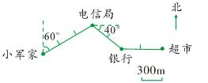

# Mathematics (Grade 6)

**ID**: 861cc1ce
**难度**: medium
**题型**: multiple_choice

## 题目
以电信局为观测点，银行在（   ）方向上。以电信局为观测点，银行距离电信局（   ）米。

A．西偏北40°；300
B．东偏南40°；600
C．西偏南40°；600

## 解答

**答案**: B

1. Step1:根据图中方向标识，上北下南左西右东，以电信局为观测点，银行在电信局的右下方，即东偏南方向
2. Step2:由图中标注的角度可知，银行相对于电信局的角度是40°，所以银行在电信局东偏南40°方向
3. Step3:根据图中比例尺，一格代表300米，电信局到银行间隔2格，300×2 = 600米，所以银行距离电信局600米
4. Step4:综合方向和距离，答案是B

## 知识点

**知识点**:
  - 小学数学;图形与几何;位置与方向;根据方向、角度和距离确定物体的位置

---
