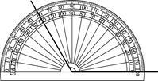

# Mathematics (Grade 6)

**ID**: 87989b04
**难度**: medium
**题型**: multiple_choice

## 题目
下图中角的度数是(  )。

$\begin{description}
\item A．120°\item B．60°\item C．70°
\end{description}$

## 解答

**答案**: A

1. Step1:观察量角器可知，角的一条边与量角器的内圈0刻度线重合，另一条边对应的内圈刻度是120°
2. Step2:根据量角器测量角的度数的方法，可确定该角的度数是120°
3. Step3:对比选项，120°对应的是A选项

## 知识点

**知识点**:
  - 小学数学;图形与几何;平面图形;角;角的度量

---
