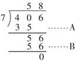

# Mathematics (Grade 6)

**ID**: 898e2f4d
**难度**: medium
**题型**: multiple_choice

## 题目
比较下面竖式中A和B的大小（  ）。

A．A＞B
B．A＜B
C．不确定

## 解答

**答案**: A

1. Step1:在该除法竖式中，A是40除以7的余数，计算可得40÷7 = 5……5，所以A = 5
2. Step2:B是56除以7的余数，计算可得56÷7 = 8……0，所以B = 0
3. Step3:比较A和B的大小，5＞0，即A＞B

## 知识点

**知识点**:
  - 小学数学;数与代数;数的运算;整数的四则运算;整数除法

---
