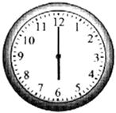

# Mathematics (Grade 6)

**ID**: 89b2e4bc
**难度**: medium
**题型**: multiple_choice

## 题目
钟面上表示的时刻是（   ）。 

A．6时
B．9时半
C．7时
D．2时半

## 解答

**答案**: A

1. Step1:观察钟面，时针指向6，分针指向12
2. Step2:根据钟面时刻的判断规则，时针指向几就是几时，分针指向12表示整时，所以此时刻为6时
3. Step3:对比选项，A选项为6时，符合钟面表示的时刻

## 知识点

**知识点**:
  - 小学数学;数与代数;常见的量;时间单位及换算;认识钟面指针及时间读法;整点时间与钟面指针的位置

---
