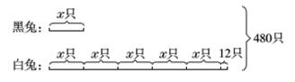

# Mathematics (Grade 6)

**ID**: 8ae2a243
**难度**: medium
**题型**: multiple_choice

## 题目
看下图，列的方程正确的是(  )。

$\begin{description}
\item A．5x＋12＝480\item B．5x－12＝480\item C．6x＋12＝480
\end{description}$

## 解答

**答案**: C

1. Step1:分析图中信息，黑兔有x只，白兔有5x + 12只
2. Step2:已知黑兔和白兔总数是480只，所以可列方程为x + (5x + 12) = 480
3. Step3:化简方程x + (5x + 12) = 480，得到6x + 12 = 480
4. Step4:对比选项，得出正确答案是C

## 知识点

**知识点**:
  - 小学数学;数与代数;式与方程;方程的意义

---
