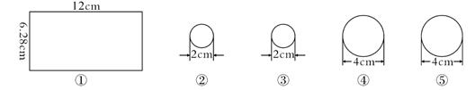

# Mathematics (Grade 6)

**ID**: 8b80bf64
**难度**: medium
**题型**: multiple_choice

## 题目
下面的材料中，（   ）能做成圆柱。

$\begin{description}
\item A．①②③\item B．①④⑤\item C．①②④
\end{description}$

## 解答

**答案**: A

1. Step1:要做成圆柱，需要一个长方形作为侧面，两个相同的圆作为底面。
2. Step2:①是长方形，可作为圆柱侧面。
3. Step3:②和③圆的直径都是2cm，它们是相同的圆，可作为圆柱底面。
4. Step4:④和⑤圆的直径都是4cm，但与②③的圆不相同，且①的长和宽与④⑤组成圆柱时不匹配。
5. Step5:综合以上分析，①②③能做成圆柱，所以答案选A。

## 知识点

**知识点**:
  - 

---
