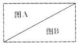

# Mathematics (Grade 6)

**ID**: 8e9dc691
**难度**: medium
**题型**: multiple_choice

## 题目
图A和图B的周长相比较（  ）。

A．图A长
B．图B长
C．一样长

## 解答

**答案**: C

1. Step1:图A的周长是长方形的一条长、一条宽与中间斜线长度之和
2. Step2:图B的周长也是长方形的一条长、一条宽与中间斜线长度之和
3. Step3:因为组成图A和图B周长的部分长度都相同，所以图A和图B周长一样长，答案选C

## 知识点

**知识点**:
  - 小学数学;图形与几何;平面图形;三角形;三角形的周长

---
