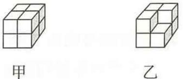

# Mathematics (Grade 6)

**ID**: 8fe31fe1
**难度**: medium
**题型**: multiple_choice

## 题目
图中甲和乙的表面积大小关系是（    ）

   A．甲＞乙
   B．甲＜乙
   C．甲＝乙
   D．无法比较

## 解答

**答案**: C

1. Step1:观察图形乙，发现它是在图形甲的基础上挖走一个长方体得到的。
2. Step2:分析挖走长方体后乙的面的变化情况，可知多出的三个面恰好是原长方体的前面、上面、右面的各个小面。
3. Step3:因为多出的面恰好补充了挖走部分的面，所以乙的表面积和甲的表面积相比没有变化。
4. Step4:根据上述分析，得出甲和乙的表面积相等，答案选C。

## 知识点

**知识点**:
  - 分数乘法-分数乘小数-

---
