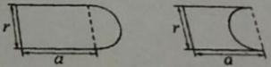

# Mathematics (Grade 6)

**ID**: 918698f2
**难度**: medium
**题型**: multiple_choice

## 题目
下面两个图形相比，(    )。
 A．周长相等
 B．面积相等
 C．周长和面积都相等

## 解答

**答案**: A

1. Step1:计算第一个图形的周长，长方形的两条长为2a，两条宽中的一条宽完整，另一条宽只有一部分，还有一个半圆的弧长，半圆的弧长为rπ÷2，所以周长是2a + r + rπ÷2
2. Step2:计算第二个图形的周长，同样长方形的两条长为2a，两条宽中的一条宽完整，另一条宽只有一部分，还有一个半圆的弧长，半圆的弧长为rπ÷2，所以周长是2a + r + rπ÷2
3. Step3:比较两个图形的周长，发现二者周长表达式相同，所以周长相等
4. Step4:计算第一个图形的面积，是长方形面积ar加上半圆面积π(rac{r}{2})^{2}
5. Step5:计算第二个图形的面积，是长方形面积ar减去半圆面积π(rac{r}{2})^{2}
6. Step6:比较两个图形的面积，二者面积表达式不同，所以面积不相等
7. Step7:综合以上，选择A

## 知识点

**知识点**:
  - --

---
