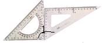

# Mathematics (Grade 6)

**ID**: 92288f52
**难度**: medium
**题型**: multiple_choice

## 题目
下图是用一副三角尺拼成的图形，∠1＝（   ）°。

A．105
B．120
C．150

## 解答

**答案**: C

1. Step1:观察图形可知，拼成∠1的两个角分别是直角和60°的角
2. Step2:直角的度数为90°
3. Step3:求∠1的度数，将两个角的度数相加，即90° + 60° = 150°
4. Step4:对比选项，发现C选项为150°，所以答案选C

## 知识点

**知识点**:
  - 

---
