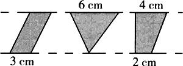

# Mathematics (Grade 6)

**ID**: 9289e489
**难度**: medium
**题型**: multiple_choice

## 题目
下图中两条平行线之间的三个图形的面积相比较，正确的是(    )．

A．平行四边形的面积大
B．三角形的面积大
C．三个图形的面积相等

## 解答

**答案**: C

1. Step1:设两条平行线之间的距离为h，这是三个图形的高。
2. Step2:根据平行四边形面积公式S = 底×高，此平行四边形底为3cm，高为h，则其面积S1 = 3h。
3. Step3:根据三角形面积公式S = 底×高÷2，此三角形底为6cm，高为h，则其面积S2 = 6h÷2 = 3h。
4. Step4:根据梯形面积公式S=(上底 + 下底)×高÷2，此梯形上底为2cm，下底为4cm，高为h，则其面积S3=(2 + 4)h÷2 = 3h。
5. Step5:比较三个图形面积，S1 = S2 = S3 = 3h，所以三个图形面积相等，答案选C。

## 知识点

**知识点**:
  - 小学数学;图形与几何;平面图形;平行四边形;平行四边形的面积;梯形的特征及分类;梯形的面积;三角形;三角形的面积

---
