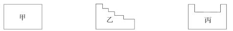

# Mathematics (Grade 6)

**ID**: 930e4f4a
**难度**: medium
**题型**: multiple_choice

## 题目
如图，甲、乙、丙三个图形的周长相比，(  )．

$\begin{description}
\item A．甲的周长长\item B．乙的周长长\item C．丙的周长长
\end{description}$

## 解答

**答案**: C

1. Step1:将乙图形的阶梯状线条进行平移，可发现乙图形的周长与甲图形的周长相等，都等于一个长方形的周长。
2. Step2:观察丙图形，将其内部凹进去的两条线段向外平移，会发现丙图形的周长比长方形的周长多了两条凹进去部分的竖线段长度。
3. Step3:比较甲、乙、丙的周长，因为丙图形的周长比长方形周长（即甲、乙的周长）多了部分线段长度，所以丙的周长长，答案选C。

## 知识点

**知识点**:
  - 小学数学;图形与几何;平面图形;长方形和正方形;长方形的周长

---
