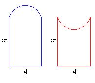

# Mathematics (Grade 6)

**ID**: 9601e270
**难度**: medium
**题型**: multiple_choice

## 题目
比较下面两个图形的周长(单位：厘米)，结果是左图（）右图

$\begin{description}
\item A．＞\item B．＜\item C．＝\item D．≠
\end{description}$

## 解答

**答案**: C

1. Step1:观察左图，其周长由长方形的一条长、两条宽以及半圆的弧长组成，长方形长为4厘米，宽为3厘米，半圆直径为4厘米。
2. Step2:计算左图周长，长方形部分周长为4 + 3×2 = 10厘米，半圆的弧长为3.14×4÷2 = 6.28厘米，所以左图周长为10 + 6.28 = 16.28厘米。
3. Step3:观察右图，其周长同样由长方形的一条长、两条宽以及半圆的弧长组成，长方形长为4厘米，宽为3厘米，半圆直径为4厘米。
4. Step4:计算右图周长，长方形部分周长为4 + 3×2 = 10厘米，半圆的弧长为3.14×4÷2 = 6.28厘米，所以右图周长为10 + 6.28 = 16.28厘米。
5. Step5:比较左右两图周长，发现二者均为16.28厘米，所以左图周长等于右图周长，答案选C。

## 知识点

**知识点**:
  - 小学数学;图形与几何;平面图形;组合图形的周长

---
