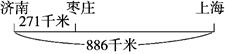

# Mathematics (Grade 6)

**ID**: 974d0d55
**难度**: medium
**题型**: multiple_choice

## 题目
枣庄到上海的距离是(  )。

$\begin{description}
\item A．615千米\item B．1157千米\item C．886千米
\end{description}$

## 解答

**答案**: A

1. Step1:已知济南到枣庄是271千米，济南到上海是886千米，要求枣庄到上海的距离，根据距离关系可知，用济南到上海的距离减去济南到枣庄的距离，即886 - 271 。
2. Step2:计算886 - 271 = 615千米。
3. Step3:对比选项，发现A选项为615千米，所以答案是A。

## 知识点

**知识点**:
  - 小学数学;数与代数;数的运算;整数的四则运算;整数的加法、减法

---
