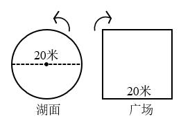

# Mathematics (Grade 6)

**ID**: 982215fc
**难度**: medium
**题型**: multiple_choice

## 题目
爸爸喜欢沿着湖边小路晨跑，妈妈喜欢沿着广场小路晨跑，如果都跑一圈，（）跑的路程长。 

A.爸爸
B.妈妈
C.无法确定

## 解答

**答案**: B

1. Step1:明确需要比较爸爸和妈妈跑一圈路程的长短，爸爸沿直径为20米的圆形湖边跑，妈妈沿边长为20米的正方形广场跑
2. Step2:根据圆的周长公式C＝πd，其中d = 20米，π取3.14，计算爸爸跑一圈的路程，即3.14×20 = 62.8米
3. Step3:根据正方形的周长公式C＝4a，其中a = 20米，计算妈妈跑一圈的路程，即20×4 = 80米
4. Step4:比较爸爸和妈妈跑一圈的路程，62.8＜80，得出妈妈跑的路程长

## 知识点

**知识点**:
  - 

---
