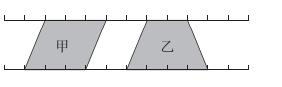

# Mathematics (Grade 6)

**ID**: 994cd16a
**难度**: medium
**题型**: multiple_choice

## 题目
下图中每小格的长度是1 cm，甲、乙两图的面积相比，(  )．

A．甲＝乙
B．甲>乙
C．甲<乙

## 解答

**答案**: A

1. Step1:计算甲图面积，甲图是平行四边形，底为2厘米，高为2厘米，根据平行四边形面积公式S=底×高，可得甲图面积为2×2 = 4平方厘米
2. Step2:计算乙图面积，乙图是梯形，上底为1厘米，下底为3厘米，高为2厘米，根据梯形面积公式S=(上底 + 下底)×高÷2，可得乙图面积为(1 + 3)×2÷2 = 4平方厘米
3. Step3:比较甲、乙两图面积，甲图面积为4平方厘米，乙图面积也为4平方厘米，所以甲＝乙，答案选A

## 知识点

**知识点**:
  - 

---
