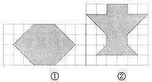

# Mathematics (Grade 6)

**ID**: 999fc8c0
**难度**: medium
**题型**: multiple_choice

## 题目
图①的面积(     )图②的面积。

A．>
B．<
C．=

## 解答

**答案**: A

1. Step1:假设每个小方格的面积为1。
2. Step2:数出图①中完整的小方格有6个，不完整但能拼凑成完整小方格的部分可拼成2个完整小方格，所以图①的面积为6 + 2 = 8。
3. Step3:数出图②中完整的小方格有7个，不完整但能拼凑成完整小方格的部分可拼成1个完整小方格，所以图②的面积为7 + 1 = 8。
4. Step4:比较图①和图②的面积，二者均为8，所以图①的面积等于图②的面积，答案选C。

## 知识点

**知识点**:
  - 小学数学;图形与几何

---
