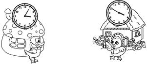

# Mathematics (Grade 6)

**ID**: 9c1d8e5d
**难度**: medium
**题型**: multiple_choice

## 题目
小鸭从家里出发,到小鸡家去做客,路上用了(  )分钟。

A．55
B．50
C．45

## 解答

**答案**: C

1. Step1:观察图中两个时钟，第一个时钟时针指向9和10之间，分针指向2，此时时间为9时10分，这是小鸭出发时间；第二个时钟时针指向9和10之间，分针指向11，此时时间为9时55分，这是小鸭到达小鸡家的时间。
2. Step2:用到达时间9时55分减去出发时间9时10分，即9时55分 - 9时10分 = 45分钟，得到路上所用时间。
3. Step3:对比选项，45分钟对应的是C选项，所以答案是C。

## 知识点

**知识点**:
  - 小学数学;数与代数;常见的量;时间单位及换算;经过时间的计算

---
