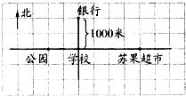

# Mathematics (Grade 6)

**ID**: 9cadefad
**难度**: medium
**题型**: multiple_choice

## 题目
赵华同学从学校出发向西直走了20分钟，每分钟走76米．她现在走到公园的（  ）面．
A．东
B．南
C．西
D．北

## 解答

**答案**: C

1. Step1:根据题目可知赵华从学校出发向西走，速度是每分钟76米，走了20分钟，根据路程=速度×时间，可得赵华行走的路程为76×20=1520米
2. Step2:观察图形，确定公园到学校的距离是1000米
3. Step3:比较赵华行走的路程1520米和公园到学校的距离1000米，因为1520米＞1000米，所以赵华走过了公园
4. Step4:由于赵华是从学校向西走，走过公园后，此时她在公园的西面，所以答案选C

## 知识点

**知识点**:
  - 根据方向和距离确定物体的位置．

---
