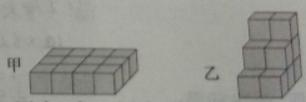

# Mathematics (Grade 6)

**ID**: 9e7eb9de
**难度**: medium
**题型**: multiple_choice

## 题目
用棱长是1厘米的小正方体垒成甲、乙两个物体，它们所占的空间比较，(      ) ．

 A．正方体大
 B．长方体大
 C．一样大

## 解答

**答案**: C

1. Step1:明确题目所求为比较甲、乙两个物体所占空间大小，而所占空间大小即物体体积
2. Step2:观察发现图中甲、乙两个物体均由棱长为1厘米的小正方体垒成
3. Step3:数出甲物体中小正方体的数量为12个
4. Step4:数出乙物体中小正方体的数量为12个
5. Step5:因为每个小正方体体积为1×1×1 = 1立方厘米，所以甲物体体积为12×1 = 12立方厘米
6. Step6:同理，乙物体体积也为12×1 = 12立方厘米
7. Step7:得出甲、乙两个物体体积相等，即它们所占空间一样大

## 知识点

**知识点**:
  - --

---
