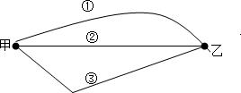

# Mathematics (Grade 6)

**ID**: 9edf1fd4
**难度**: medium
**题型**: multiple_choice

## 题目
一只蚂蚁从甲地到乙地有三条不同的路线，三条路线相比较，(  )

A．路线1最短
B．路线2最短
C．路线3最短
D．三条一样长

## 解答

**答案**: B

1. Step1:明确问题是比较从甲地到乙地三条路线的长短
2. Step2:回忆知识点，即两点之间线段最短
3. Step3:观察图中三条路线，发现路线②是线段
4. Step4:得出路线②最短的结论，所以答案选B

## 知识点

**知识点**:
  - 直线、线段和射线的认识．

---
