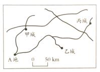

# Mathematics (Grade 6)

**ID**: 9f40347d
**难度**: medium
**题型**: multiple_choice

## 题目
如下图：一辆汽车早上8：00从A地出发，以平均每小时60千米的速度行驶，11：30到达目的地。目的地应该是（   ）。

A．甲城
B．乙城
C．丙城

## 解答

**答案**: C

1. Step1:计算汽车行驶时间，11时30分 - 8时 = 3小时30分，30分 = 0.5小时，所以行驶时间为3.5小时
2. Step2:根据速度和时间计算行驶路程，速度为每小时60千米，行驶时间3.5小时，路程 = 速度×时间 = 60×3.5 = 210千米
3. Step3:根据图中比例尺，图上1厘米代表实际50千米，210÷50 = 4.2厘米，测量图中A地到丙城的距离符合
4. Step4:得出目的地是丙城，答案选C

## 知识点

**知识点**:
  - 小学数学;数与代数;比和比例;比例;图上距离与实际距离的换算;应用题;常见的数学问题;行程问题

---
