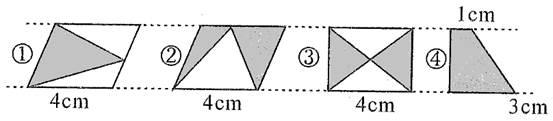

# Mathematics (Grade 6)

**ID**: a1d3f9d6
**难度**: medium
**题型**: multiple_choice

## 题目
如图，选出阴影部分面积相等的图形，答案完全正确的是（   ）。

A．①②
B．①②④
C．①②③
D．①②③④

## 解答

**答案**: D

1. Step1:设①中平行四边形的高为$h$，根据平行四边形面积公式$S = 底×高$，其面积为$4h$，那么①中阴影部分面积为平行四边形面积的一半，即$\frac{1}{2}×4h = 2h$。
2. Step2:设②中平行四边形的高为$h$，其面积为$4h$，②中两个阴影三角形的底之和为$4$，高都为$h$，根据三角形面积公式$S=\frac{1}{2}×底×高$，两个阴影三角形面积之和为$\frac{1}{2}×4×h = 2h$。
3. Step3:设③中长方形的长为$4$，宽为$b$，长方形面积为$4b$，③中四个三角形等底等高，阴影部分占一半，所以阴影部分面积为$\frac{1}{2}×4b = 2b$。
4. Step4:设④中梯形的高为$h$，根据梯形面积公式$S = \frac{(上底 + 下底)×高}{2}$，其面积为$\frac{(1 + 3)×h}{2}=2h$。
5. Step5:比较①②③④中阴影部分面积，均为$2$倍对应图形的高，所以①②③④阴影部分面积相等，答案选D。

## 知识点

**知识点**:
  - 

---
