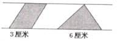

# Mathematics (Grade 6)

**ID**: a59eb508
**难度**: medium
**题型**: multiple_choice

## 题目
下图是在一组平行线之间画出了一个底是3cm的平行四边形和一个底是6厘米的三角形。两者的面积相比较（  ）。       

A．三角形的面积大
B．平行四边形的面积大
C．一样大

## 解答

**答案**: C

1. Step1:设平行线间的距离为h，这也是平行四边形和三角形的高。
2. Step2:根据平行四边形面积公式S = 底×高，可得平行四边形面积S1 = 3×h = 3h平方厘米。
3. Step3:根据三角形面积公式S = 底×高÷2，可得三角形面积S2 = 6×h÷2 = 3h平方厘米。
4. Step4:比较S1和S2，因为S1 = 3h平方厘米，S2 = 3h平方厘米，所以S1 = S2，即两者面积一样大，答案选C。

## 知识点

**知识点**:
  - 小学数学;图形与几何;平面图形;平行四边形;平行四边形的面积;三角形;三角形的面积

---
