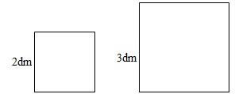

# Mathematics (Grade 6)

**ID**: a6e68141
**难度**: medium
**题型**: multiple_choice

## 题目
李老师准备给健身房铺正方形地砖，如果选择边长为3dm的地砖要400块．那么选择边长为2dm的地砖要（  ）块．

A．600
B．900
C．1200
D．1800

## 解答

**答案**: B

1. Step1:因为健身房面积一定，方砖面积和块数成反比例，设选择边长为2dm的地砖要x块
2. Step2:边长为3dm的地砖面积为3×3 = 9（dm²），400块的面积为9×400
3. Step3:边长为2dm的地砖面积为2×2 = 4（dm²），x块的面积为4x
4. Step4:根据反比例关系列出方程2×2×x = 3×3×400，即4x = 3600
5. Step5:求解方程4x = 3600，得出x = 900

## 知识点

**知识点**:
  - 正、反比例应用题．

---
