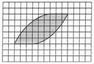

# Mathematics (Grade 6)

**ID**: aa33c5db
**难度**: medium
**题型**: multiple_choice

## 题目
下图中每个方格的面积是1cm$^{2}$,估计这片树叶的面积大约是（      ）cm²。

$\begin{description}
\item A．20\item B．25\item C．35
\end{description}$

## 解答

**答案**: B

1. Step1:观察图形，可知树叶大约占了25个方格
2. Step2:因为每个方格面积是1cm²，所以树叶面积大约是25×1 = 25cm²
3. Step3:对比选项，答案是B

## 知识点

**知识点**:
  - 小学数学;图形与几何;平面图形;不规则图形的面积

---
