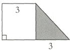

# Mathematics (Grade 6)

**ID**: aa41b2ce
**难度**: medium
**题型**: multiple_choice

## 题目
图中阴影部分的面积是空白部分面积的（  ）

A．一半
B．相等
C．2倍
D．无法比较

## 解答

**答案**: A

1. Step1:观察图形，确定正方形与三角形等底等高
2. Step2:根据正方形面积公式S=a²（a为边长），此正方形边长为3，其面积为3×3 = 9
3. Step3:根据三角形面积公式S=ah÷2（a为底，h为高），此三角形底和高均为3，其面积为3×3÷2 = 4.5
4. Step4:空白部分是正方形，面积为9，阴影部分是三角形，面积为4.5，4.5是9的一半，所以图中阴影部分的面积是空白部分面积的一半

## 知识点

**知识点**:
  - 组合图形的面积．

---
