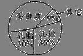

# Mathematics (Grade 6)

**ID**: ac3d1c60
**难度**: medium
**题型**: multiple_choice

## 题目
如图是一种奶粉成分含量情况统计图，已知蛋白质的含量是225克，则乳脂的含量是（   ）克。

$\begin{description}
\item A．900\item B．270\item C．81
\end{description}$

## 解答

**答案**: B

1. Step1:根据统计图可知蛋白质含量占奶粉总量的25%，已知蛋白质含量为225克，所以奶粉总量为225÷25% = 900克
2. Step2:由统计图得知乳脂含量占奶粉总量的30%，奶粉总量为900克，那么乳脂含量是900×30% = 270克

## 知识点

**知识点**:
  - 小学数学;统计和概率;统计;统计图;扇形统计图的特点及绘制

---
