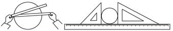

# Mathematics (Grade 6)

**ID**: aca73bb2
**难度**: medium
**题型**: multiple_choice

## 题目
用下面的方法可以测量出没有标出圆心的圆的直径,是因为(  )。

$\begin{description}
\item A．两端都在圆上的线段,直径是最长的一条。\item B．直径通过圆心并两端在圆上\item C．在这个圆里,直径的长度是半径的2倍
\end{description}$

## 解答

**答案**: A

1. Step1:观察测量圆直径的方法，是用两个三角板夹住圆，在直尺上读出长度。
2. Step2:思考其原理，这种测量方式实际测量的是圆中最长的线段。
3. Step3:根据圆的性质，两端都在圆上的线段中，直径是最长的一条，这符合测量圆直径方法的原理。
4. Step4:对比选项，A选项“两端都在圆上的线段，直径是最长的一条”符合上述原理，所以答案是A。

## 知识点

**知识点**:
  - 

---
