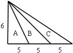

# Mathematics (Grade 6)

**ID**: adf839ec
**难度**: medium
**题型**: multiple_choice

## 题目
如图所示，下面说法正确的是(  )

A．三角形A的面积最大
B．三角形B的面积最大
C．三角形C的面积最大
D．三角形A、B、C的面积一样大

## 解答

**答案**: D

1. Step1:观察图形，发现三角形A、B、C的底均为5
2. Step2:观察图形，发现三角形A、B、C的高均为6
3. Step3:因为三角形面积公式为S = 1/2×底×高，且三个三角形底和高都分别相等
4. Step4:根据等底等高的三角形面积相等，得出三角形A、B、C的面积一样大
5. Step5:所以答案选D

## 知识点

**知识点**:
  - 面积及面积的大小比较．

---
